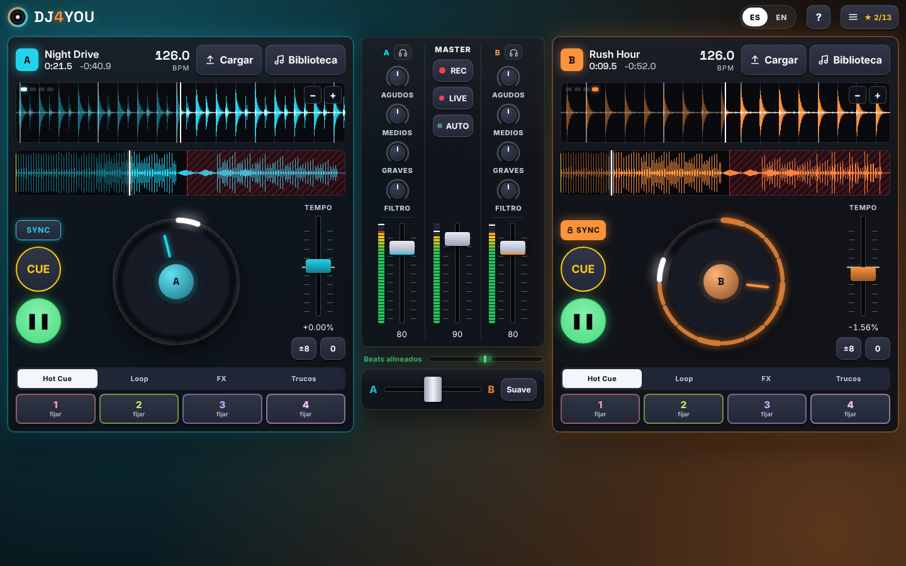
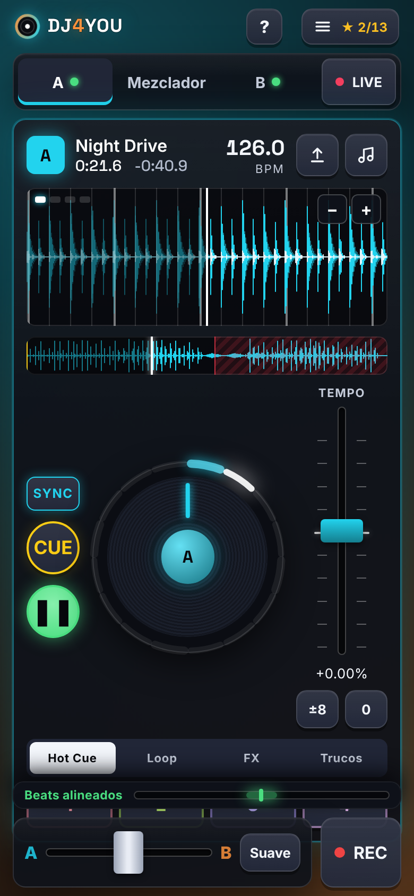

<div align="center">

# 🎧 DJ4YOU

**Una consola de DJ en el navegador. Cualquiera con un celular o una PC puede mezclar.**

🎛️ Orquestado por **Foker** ([fokerone](https://github.com/fokerone)) · 🤖 Desarrollado por **[Claude Code](https://claude.com/claude-code)**

**v1.1.0** · [**▶ Abrir DJ4YOU**](https://fokerone.github.io/dj4you/) · [Ayuda dentro de la app](https://fokerone.github.io/dj4you/#ayuda)



</div>

---

## Qué es

DJ4YOU es una consola de DJ completa que funciona en el navegador, sin instalar nada y sin cuenta.
Dos decks, un mezclador, efectos, auriculares para preescuchar, grabación y transmisión en vivo,
con una interfaz pensada primero para el celular. Se puede instalar como app (PWA) y funciona sin conexión.

La app está en **español e inglés** y trae una página de ayuda que explica cada control.

<p align="center"></p>

## Funciones

### Decks
- **Forma de onda** con zoom (de 2 a 32 segundos) y colores por banda, más la **vista general** del tema para saltar a cualquier punto.
- **Detección de BPM, grilla de beats y tono musical** (rueda Camelot, p. ej. `8A`) automáticas, en un worker sin trabar la interfaz. Si un tema no tiene un beat claro, **TAP**: tocás la caja de BPM al ritmo y lo fijás a mano.
- **CUE automático** en el primer beat: al cargar un tema se salta el silencio del principio.
- **SYNC con bloqueo**: iguala el tempo y alinea los beats (también a doble o medio tempo) y sigue al otro deck mientras esté activo.
- **Fader de tempo** con rangos **±8 / ±16 / ±30 / ±50 %**: SYNC llega tan lejos como el rango que elijas.
- **Jog** para empujar o frenar el tema, **CUE** estilo club, **4 hot cues**, **loops** de 1, 2, 4 u 8 tiempos.
- **Efectos**: eco a tempo (1/4 a 1 tiempo) y reverb, con knob de cantidad.
- **Trucos**: freno de plato, spinback, beat-roll (1/2, 1/4 u 1/8 de tiempo, que al soltar retoma donde iría el tema) y flanger.
- **Aviso de fin de tema**: los últimos segundos se marcan en rojo y el deck parpadea antes de que termine (15, 30 o 60 s, o desactivado).

### Mezclador
- Ecualizador de **3 bandas** y **filtro** de un solo knob por canal.
- Faders de canal, **master** con limitador y medidores.
- **Crossfader** con curva suave o de corte.
- **Medidor de fase** que dice en palabras si los beats van juntos o chocan.
- **Auriculares** (modo dividido con cable Y: izquierda auriculares, derecha parlantes) para escuchar el próximo tema antes de que suene.
- **AUTO**: DJ4YOU mezcla la cola solo (carga el siguiente tema, lo sincroniza y hace la transición en 16 tiempos con cambio de graves). Si tocás el crossfader, vuelve el control al DJ.

### Música
- **Mis temas**: lo que cargás queda guardado en el dispositivo (IndexedDB); no se sube nada.
- **Música libre de [Jamendo](https://www.jamendo.com)**: miles de temas Creative Commons buscables por artista, título o estilo. Solo se muestran licencias que permiten remezclar, y cada tema indica artista y licencia. Jamendo no da el BPM: la lista muestra su velocidad aproximada y, cuando cargás un tema, el BPM que midió DJ4YOU.
- **Combina con…**: mientras suena un tema, la biblioteca sugiere los que mejor encajan por tempo y tono, y dice por qué.
- **Cola "A continuación"**: armá el set de antemano y cargá el siguiente con ⏭ en el deck libre (o dejá que AUTO lo mezcle).
- **Favoritos ★** de cualquier origen, arriba de todo en la biblioteca.
- **Buscar, ordenar y filtrar** tus temas por nombre, BPM, tono o duración; los que agregás sin reproducir se analizan solos en segundo plano.
- **Pack de inicio**: 7 beats generados en el navegador (house, techno, hip-hop a 90, drum & bass a 174).
- Al volver, los decks se recargan donde los dejaste y la biblioteca recuerda la pestaña y el estilo elegidos.

### Grabar y salir en vivo
- **REC** graba exactamente lo que sale por el master; al terminar hay un **resumen de la sesión** (setlist, transiciones, logros) para compartir.
- **LIVE** transmite la mezcla en estéreo a **hasta 20 oyentes** por WebRTC, con enlace, código QR y una sala pública "En vivo ahora".
- **Reacciones**: los oyentes mandan 🔥 🙌 ❤️ 😮 🕺, que flotan sobre la consola del DJ y en la pantalla de los demás oyentes.

### Para aprender
- Tutorial guiado para la primera mezcla, consejos cuando los beats chocan (con un botón para arreglarlo) y **13 logros**.
- Página de **ayuda** con buscador que ilumina cada control en pantalla (tecla `?`, desde el menú o con el enlace `#ayuda`).

## Atajos de teclado

| Acción | Deck A | Deck B |
| --- | --- | --- |
| Play / pausa | `Q` | `P` |
| CUE (mantener para escuchar) | `W` | `O` |
| SYNC | `Z` | `M` |
| Hot cues | `1` – `4` | `7` `8` `9` `0` |
| Play del deck que más se oye | `Espacio` | |
| Crossfader | `←` / `→` (con `Shift`: hasta el extremo) | |
| Ayuda | `?` | |

## Desarrollo

Requiere Node 20 o superior.

```bash
npm install
npm run dev
```

```bash
npm run build           # sitio estático en dist/ (PWA)
npm run build:artifact  # un único HTML autocontenido en dist-artifact/
npm run lint
npm test                # tests de BPM, tono, cue automático, SYNC y protocolo del vivo
```

### Variables de entorno (opcionales)

| Variable | Para qué |
| --- | --- |
| `VITE_JAMENDO_CLIENT_ID` | Tu propio client id de la API de Jamendo (hay uno por defecto). |
| `VITE_SIGNAL_URL` | URL del servidor de señalización propio (activa la sala "En vivo ahora"). |

### Estructura

```
src/
  audio/       motor de audio (TypeScript + Web Audio API): decks, mezclador, FX,
               análisis de BPM en un worker, grabador, beats de demo
  components/  interfaz en React
  library/     biblioteca en el dispositivo, Jamendo, favoritos y preferencias
  live/        transmisión en vivo (PeerJS / WebRTC)
  listen/      páginas del oyente y de la sala (?listen=<id>, ?live)
  game/        tutorial, consejos y logros
  help/        contenido de la página de ayuda (ES / EN)
tests/         tests (Vitest) con señales sintéticas: ritmos, acordes y ruido
  i18n.ts      traducciones
public/        manifest, service worker e íconos de la PWA
server/        servidor opcional de señalización + sala
```

El motor de audio vive fuera de React: cada deck, el mezclador y la biblioteca son *stores* simples que los componentes leen con `useSyncExternalStore`.

## Cómo funciona el vivo

La salida master del DJ (la misma que usa el grabador) viaja **de navegador a navegador** hasta cada oyente; el audio no pasa por ningún servidor. Un servidor de señalización solo presenta a los navegadores entre sí.

- **Sin servidor propio** se usa el servidor público de PeerJS: LIVE, el enlace y el QR funcionan; la sala pública queda desactivada.
- **Con el servidor de DJ4YOU** (`server/`) también aparece la sala **En vivo ahora**. Definí `VITE_SIGNAL_URL` al compilar.

Como cada oyente recibe su propio stream, la velocidad de subida del DJ pone el límite (máximo 20 oyentes, unos 200 kb/s cada uno).

## Publicar

### App web → GitHub Pages

1. Hacer push a `main`.
2. En el repositorio: **Settings → Pages → Build and deployment → Source: GitHub Actions**.
3. El workflow `Deploy to GitHub Pages` compila y publica `dist/` en `https://<usuario>.github.io/<repo>/`.

### Servidor del vivo (opcional, activa la sala)

`server/` corre en cualquier lugar con Node 20+ y WebSockets, por ejemplo [Render](https://render.com) con `render.yaml` (New → Blueprint), o con `server/Dockerfile` en Fly.io o Railway. Después agregá la variable de repositorio `SIGNAL_URL` (por ejemplo `https://dj4you-live.onrender.com`) en **Settings → Secrets and variables → Actions → Variables** y volvé a correr el deploy.

```bash
cd server && npm install && npm start   # local: http://localhost:9000
```

```bash
VITE_SIGNAL_URL=http://localhost:9000 npm run dev
```

## Versiones

DJ4YOU usa [versionado semántico](https://semver.org/lang/es/). La versión se toma de `package.json` y se muestra al pie de la bienvenida y del menú. Los cambios de cada versión están en [CHANGELOG.md](CHANGELOG.md).

## Créditos

- Idea, dirección y pruebas: **Foker** ([fokerone](https://github.com/fokerone)).
- Desarrollo: **[Claude Code](https://claude.com/claude-code)**, de Anthropic.
- Música libre: [Jamendo](https://www.jamendo.com) y sus artistas, bajo licencias Creative Commons. Respetá la licencia de cada tema (NC = sin uso comercial, SA = compartí tu mezcla con la misma licencia).

---

<sub>English: DJ4YOU is a mobile-first DJ desk that runs in the browser — two decks with BPM detection and SYNC, a 3-band EQ mixer with filter and FX, headphone cue, hot cues and loops, free Creative Commons music from Jamendo, recording and live streaming to up to 20 listeners over WebRTC. The app itself is available in English and Spanish.</sub>
